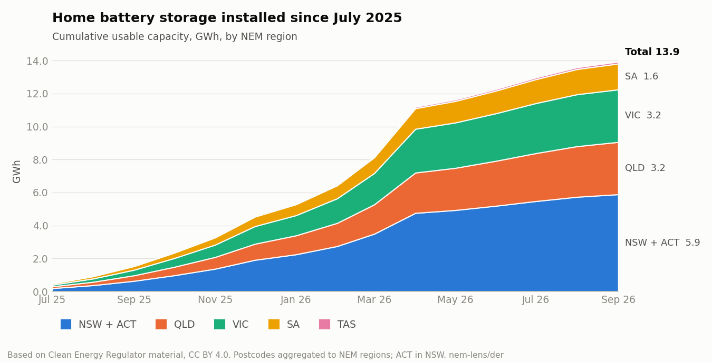
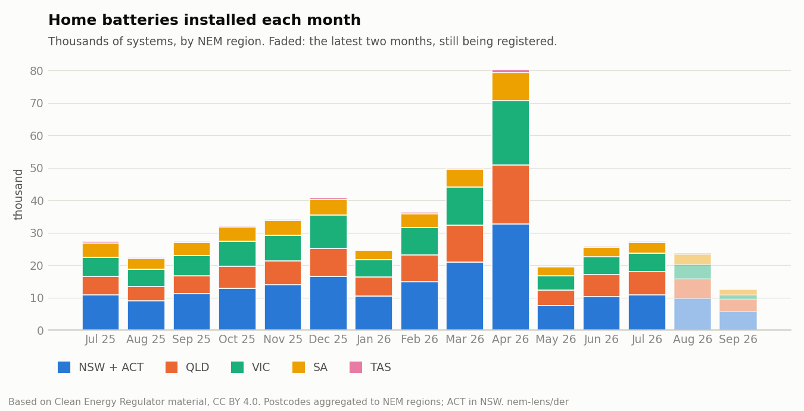
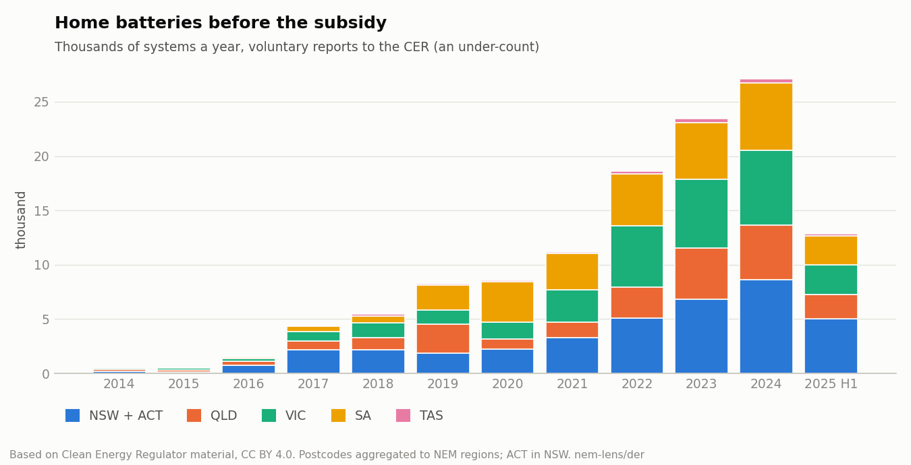
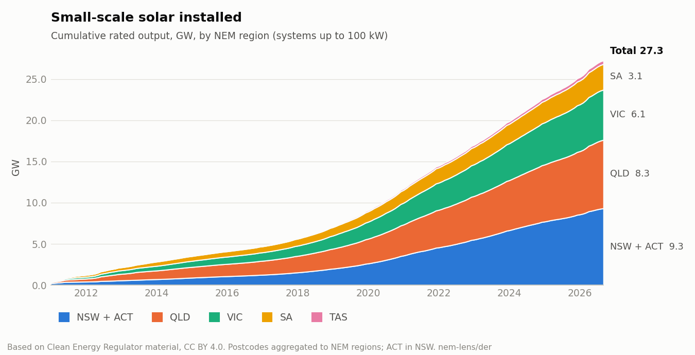
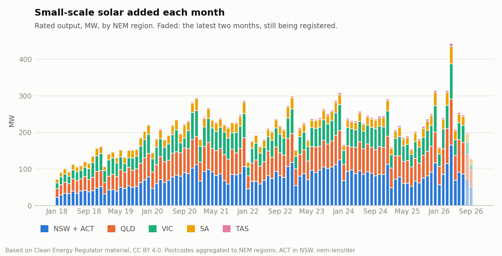
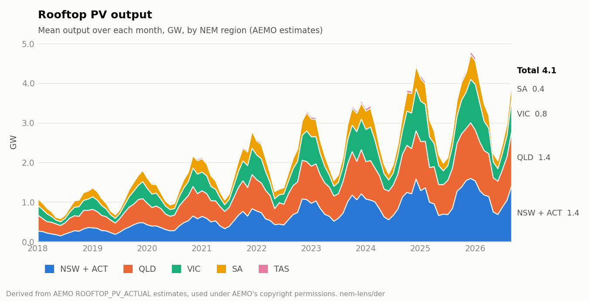
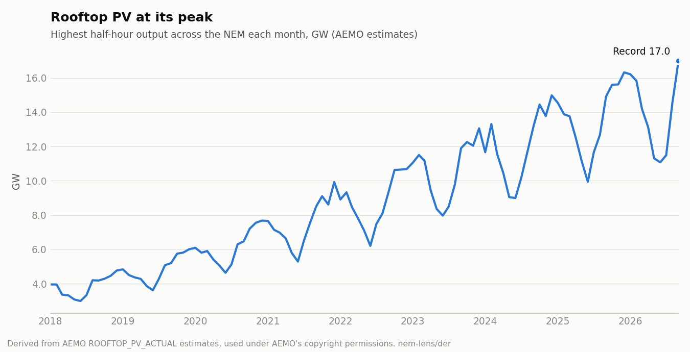

# DER in the NEM

Household batteries and rooftop solar in Australia's National Electricity
Market, by region and month. Built from public data: the Clean Energy
Regulator's (CER) small-scale installation data and AEMO's rooftop PV
estimates. Part of [NEM Lens](https://github.com/nem-lens).

## Headline figures

<!-- headline:start -->
- **Home batteries:** 546,789 installed with 15.3 GWh of usable storage, July 2025 to September 2026 (Cheaper Home Batteries Program). In the NEM's five regions: 484,205 batteries, 13.9 GWh. The voluntary record for September 2014 to June 2025 counts 138,793.
- **Where:** NSW + ACT 42%, VIC 23%, QLD 23%, SA 11%, TAS 1% of the NEM's new battery storage.
- **Busiest month:** April 2026, 87,128 batteries (3,208 MWh). Average size 17.5 kWh in Jul 2025, 36.8 kWh at its largest (Apr 2026), 25.9 kWh in Sep 2026.
- **Small-scale solar:** 30.9 GW registered with the CER nationally, 3.4 GW of it in the last 12 months.
- **Rooftop PV output (AEMO):** a NEM record of 17.0 GW in the half hour ending 12:00 on 20 September 2026. Mean output over the last 12 months 3.56 GW, 2.1× five years earlier.
- Recent months are incomplete: CER counts a system once its certificates are created, which can be up to a year after installation.
<!-- headline:end -->

## Home batteries







CER has battery capacity (kWh) by postcode only from July 2025, when home
batteries began earning small-scale technology certificates under the
Cheaper Home Batteries Program. Before that there is only a voluntary
count of batteries installed with solar, by state and year. CER says it
under-counts, and points to AEMO's DER Register as more accurate for that
period.

## Rooftop solar









Installed capacity is CER's: systems up to 100 kW, by the postcode they're
installed in. Output is AEMO's half-hourly ROOFTOP_PV_ACTUAL estimate per
region. This uses AEMO's MEASUREMENT estimate where it exists, otherwise
its SATELLITE one; the share measured is in the table. The NEM peak is
the highest half hour of the five regions' sum.

## Data

| File | Contents |
| --- | --- |
| `data/batteries_monthly_by_state.csv` | Batteries installed and usable kWh, by state and month, from July 2025 |
| `data/batteries_voluntary_yearly_by_state.csv` | Voluntary battery counts by state and year, 2014 to June 2025 |
| `data/solar_monthly_by_state.csv` | Solar systems installed and rated kW, by state and month, from 2011. Month 2010-12 holds the total before 2011. |
| `data/rooftop_pv_monthly_by_region.csv` | Rooftop PV mean and peak MW and energy (GWh) by NEM region and month, from 2018 |
| `data/rooftop_pv_nem_monthly_peak.csv` | The NEM's highest half hour of rooftop PV each month, and when |
| `data/cer_sources.json` | The CER files these came from: URL, size, SHA-256, date fetched |

States map to NEM regions with the ACT in NSW1. WA and NT are in the state
tables but not in the NEM charts. Postcodes map to states by Australia
Post's ranges (`regions.py`).

## Rebuilding

Python 3.10+ with pandas and matplotlib (`pip install -r requirements.txt`).

```sh
python fetch_cer.py     # CER files into raw/cer/<date>/
python fetch_aemo.py    # AEMO rooftop PV, one zip a month into raw/aemo/ (from 2018; skips months it has)
python build.py         # data/, charts/ and the headline figures above
```

Downloads go in `raw/`, which git ignores.

## Licences

- **Code:** Copyright (c) 2026 Archie C. Chapman, under the BSD-3-Clause
  licence (`LICENSE`).
- **CER data:** the battery and solar tables and charts are based on Clean
  Energy Regulator material licensed under a
  [Creative Commons Attribution 4.0 licence](https://creativecommons.org/licenses/by/4.0/)
  ([CER copyright](https://cer.gov.au/about-us/our-policies/copyright)).
  Changes: postcodes are aggregated to state, NEM region and month. The
  derived tables and charts are shared under the same licence.
- **AEMO data:** the rooftop PV tables and charts are derived from AEMO's
  market data, used under
  [AEMO's copyright permissions](https://www.aemo.com.au/privacy-and-legal-notices/copyright-permissions).
- Neither the CER nor AEMO has reviewed or endorsed this work.
